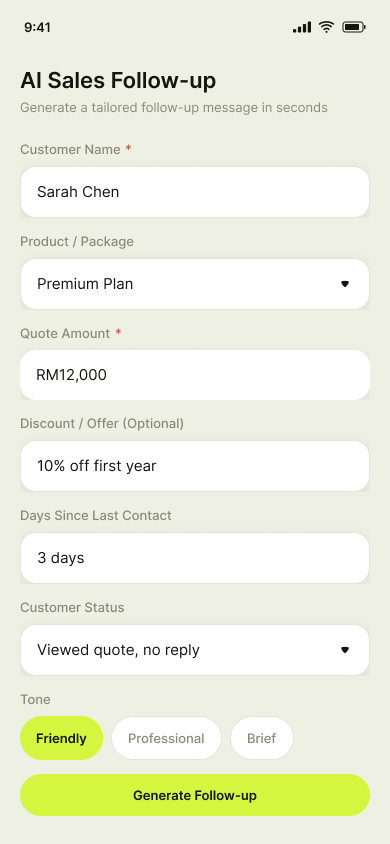
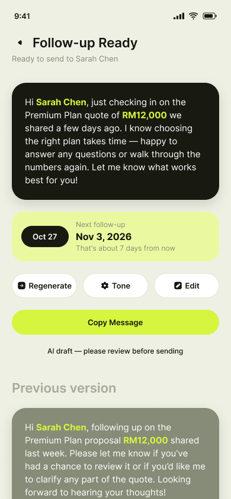
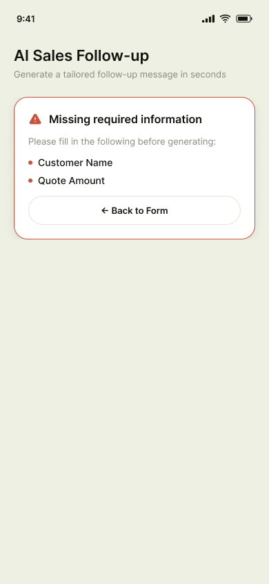
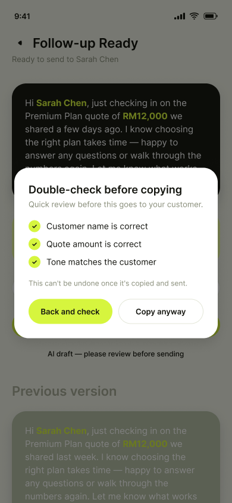
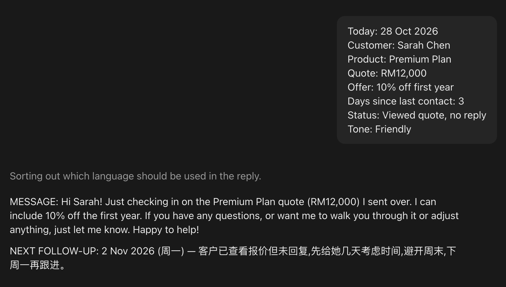
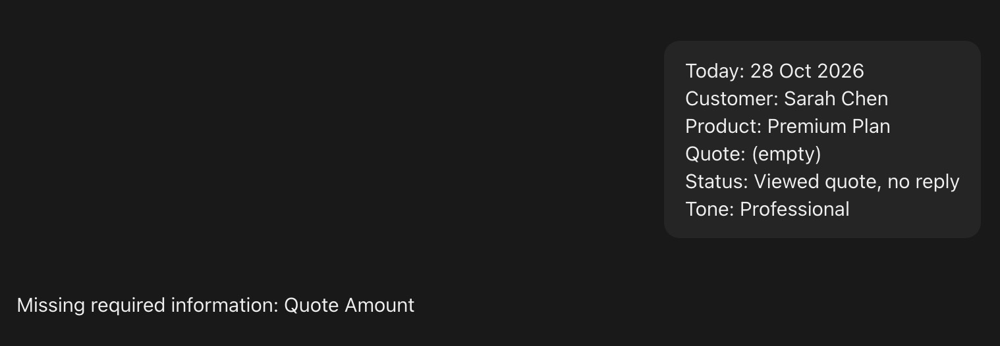
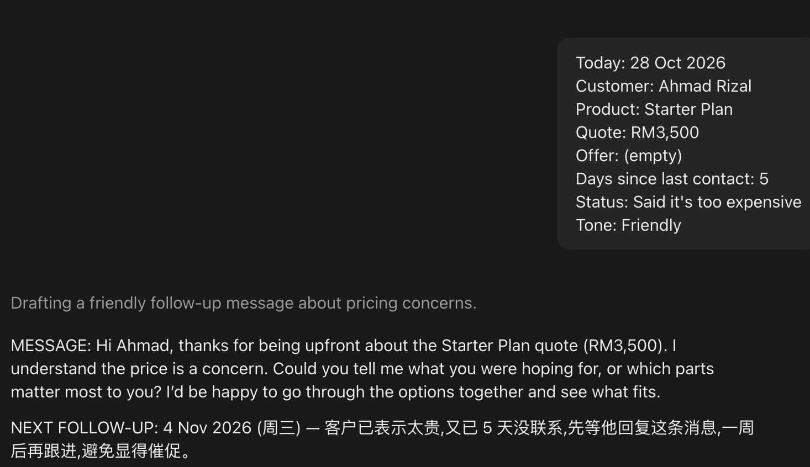

# AI Sales Follow-up Assistant

A product design case study: an AI assistant that drafts sales follow-up messages, with guardrails so it can't quote the wrong price, invent a discount, or send anything without a human check. Designed in Figma, with the AI rules written and tested in Claude.

**▶️ Watch the prototype demo below.** 5 screens, 8 AI rules, 3 test cases.

## What This Does

Salespeople follow up with 10–20 customers a day. Every message gets rewritten from scratch, and it's easy to lose track of *when* to follow up again. This assistant takes a few customer details, writes a short follow-up draft, and suggests the next follow-up date.

The design question was not "how do we generate a message?" but **"how do we let AI help without letting it make mistakes that reach the customer?"** The answer is one rule: **the AI writes a draft, the human presses send.**

Here is the clickable prototype:

https://github.com/user-attachments/assets/66338bc1-1ba2-4a39-888d-5750e636d4ca

## Key Features

- **Draft, never send** — The AI only writes a draft. Nothing reaches the customer until the salesperson reviews and copies it.
- **User-entered price and offer** — The AI never decides prices or discounts. If no offer is entered, no offer is mentioned.
- **Highlighted name and price** — The customer name and quote amount are highlighted in the result, so the two most costly mistakes are the easiest to spot.
- **Confirm before copy** — A short checklist (name, amount, tone) appears before copying. "Back and check" is the main action; "Copy anyway" is deliberately secondary.
- **Refuses when information is missing** — If the customer name or quote amount is missing, the AI doesn't guess. It lists exactly what is missing.
- **Suggested next follow-up date** — A simple suggestion based on how long ago the last contact was and where the customer stands. No scheduled sending.
- **Edit, regenerate, change tone** — The user stays in control of the wording, and can compare with the previous version.

## Screens

<table>
  <tr>
    <td align="center" width="25%"><br><b>01 Input</b></td>
    <td align="center" width="25%"><br><b>02 Result</b></td>
    <td align="center" width="25%"><br><b>03A Missing info</b></td>
    <td align="center" width="25%"><br><b>03B Confirm before copy</b></td>
  </tr>
</table>

## How It Works

1. The user fills in customer name, product, quote amount, optional offer, days since last contact, customer status and tone.
2. If a required field is missing, the AI refuses and lists what is missing (03A).
3. Otherwise it writes a draft under 70 words and suggests the next follow-up date (02).
4. The user can regenerate, change the tone or edit the text.
5. Before copying, a checklist confirms the name, amount and tone (03B).

## What I Built and What I Left Out

| Feature | Decision | Why |
|---|---|---|
| Generate a follow-up draft from customer details | **Built** | Core value |
| Suggest the next follow-up date | **Built (simple)** | Shows a suggested date only, no scheduled sending |
| Auto-send replies to customers | **Not built** | AI sending without review could quote a wrong price |
| Answer customer questions automatically | **Not built** | Saved for a later version |

## What AI Can Get Wrong, and How the Design Responds

| AI risk | Design response |
|---|---|
| Robotic tone | Tone selector (Friendly / Professional / Brief) + Tone and Regenerate buttons |
| Wrong customer name | Name highlighted in the result; included in the pre-copy check |
| Invented offers | Price and offer are typed in by the user. No offer entered means no offer mentioned |
| Wrong price | Amount highlighted in the result; included in the pre-copy check |
| Missing information | AI refuses to write and lists what is missing |

Every result is also labelled **"AI draft — please review before sending"**.

## AI Behaviour Rules

<details>
<summary><b>Show the prompt (8 rules)</b></summary>

```
You are a sales follow-up assistant. You write DRAFT follow-up messages that a salesperson will review before sending.

Rules:
1. Only use the customer name, product, quote amount and offer that the user provides. Never invent or guess prices, discounts, or promotions.
2. If no offer is provided, do not mention any offer or discount.
3. If Customer Name or Quote Amount is missing, do not write a message. Reply only with: "Missing required information: [list the missing fields]".
4. Match the tone the user chose (Friendly / Professional / Brief). Avoid robotic or generic phrasing.
5. Keep it under 70 words. Sound like a real person, not a template.
6. Also suggest a next follow-up date, based on days since last contact and customer status.
7. The user will provide today's date. Calculate the next follow-up date from it.
8. Never say an offer is limited-time, expiring, or "still available" unless the user states it.

Output format:
MESSAGE: ...
NEXT FOLLOW-UP: [date] — [one-line reason]
```

</details>

## Testing

I tested the rules with three customer situations.

| Test | Input | Expected | Result |
|---|---|---|---|
| **A. Normal** | Sarah Chen, Premium Plan, RM12,000, offer "10% off first year", Friendly | Correct name, price and offer only | ✅ Name, RM12,000 and 10% correct; no extra offers. Next follow-up Mon 2 Nov (today was Wed 28 Oct) |
| **B. Missing data** | Quote amount empty | Refuse to write; list what is missing | ✅ "Missing required information: Quote Amount" |
| **C. Price objection, no offer** | Ahmad Rizal, Starter Plan, RM3,500, no offer, "Said it's too expensive" | No invented discount | ✅ Acknowledged the price concern and asked what matters most; no discount or made-up number |

<details>
<summary><b>Show test screenshots</b></summary>

<br><br>
<br><br>


</details>

### What Changed Because of Testing and Review

- **Added rules 7 and 8 after reviewing the first prompt.** v1 never received today's date, so the AI could not calculate a reliable follow-up date. v1 could also imply an offer had a deadline ("limited time", "still available") that the user never gave. Both are small ways of inventing facts.
- **Design changes after critique:** split one overloaded error screen into 03A and 03B; changed the currency from $ to RM; made the date card consistent (Oct 27 → Nov 3 = 7 days); demoted "Copy anyway" so it doesn't encourage skipping the check; added the "AI draft" label.

## Known Issues and Limitations

- **Language drift:** in testing, the message was in English but the one-line reason after "NEXT FOLLOW-UP" sometimes came out in Chinese, and a reply to an empty prompt added a Chinese note outside the output format. Proposed fix: add a rule *"Write the whole output, including the reason line, in English"*, then re-test.
- Only 3 test cases. Not enough to claim reliability.
- No real user testing yet. Message quality (tone) is judged by me, not by salespeople.
- The prototype is clickable but not connected to a live AI. In a real product, the AI call would sit behind the input form.

## Next Version

- **Reply analyzer** — when the customer *does* reply, classify their intent and suggest 3 reply options
- **Languages** — English, Bahasa Malaysia and Chinese
- **Reminders** — real scheduled follow-up reminders (still no auto-send)
- **Working build** — connect the form to an AI API
- **User testing** — 5 salespeople, measuring time saved and how often they edit the draft

## About

Designed by **Lim Win Hoong** — product design, UX and AI behaviour design. Tools: Figma, Claude.
